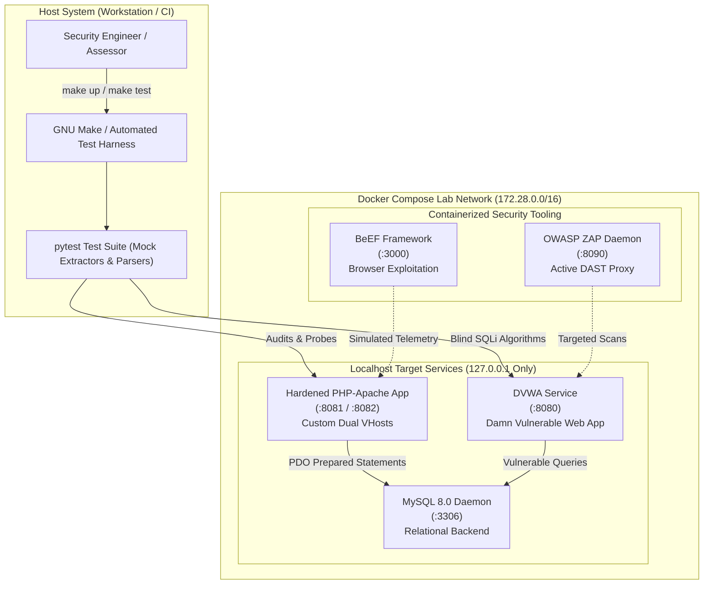

# Unified Mentor Web Security Assignments Lab Portfolio

A comprehensive, public, portfolio-grade cybersecurity laboratory and technical research repository implementing all five structured web-security assignments (**A1–A5**) from the official **Unified Mentor Internship Program**.

> 🚀 **Internship & Founder Spotlight:**  
> This repository represents the foundational cybersecurity and web technology assignment project completed during my **first internship at the age of 17 at [Unified Mentor](https://unifiedmentor.com/)**.  
> Maintained & engineered under my company **[vecesta.co](https://vecesta.co)**.  
> 
> 📄 **Official Internship PDF Brief:** [docs/Unified_Mentor_Assignment_Brief.pdf](docs/Unified_Mentor_Assignment_Brief.pdf)  
> 🔗 **Reference Implementation:** [adityasasikumar422-ui/ASSIGNMENT-1-WEB-TECHNOLOGIES](https://github.com/adityasasikumar422-ui/ASSIGNMENT-1-WEB-TECHNOLOGIES)

---

## 🧭 Project Architecture & Methodological Approach

This repository bridges offensive vulnerability exploitation with defensive software engineering. Our core approach is built around a closed-loop **Build → Test → Adversarial Review → Document** workflow:



### Key Engineering & Educational Principles:
1. **Defense-in-Depth Implementation:** Every vulnerable demonstration (in DVWA or testbed pages) is directly paired with production-grade mitigations (e.g., PDO prepared statements, input constraints, CSRF token validation, `HttpOnly`/`SameSite` session cookies, and path boundary enforcement).
2. **Strict Loopback Target Allowlist:** All automation scripts (`http_probe.py`, `check_misconfig.py`, `upload_test.py`, `blind_boolean.py`, `blind_time.py`) enforce hardcoded allowlists (`127.0.0.1`, `localhost`, `dvwa`, `php-apache`). Any request targeting external networks immediately aborts with an exit code 1.
3. **Truth-in-Documentation Policy:** All test logs and command results are genuine. Unexecuted manual tasks (such as live GUI interceptions in Burp Suite or external TryHackMe rooms) are explicitly labeled `[HUMAN-EXECUTED — PENDING]` or `NOT APPLICABLE (GUI/LIVE)` with step-by-step reproduction templates provided.

---

## 📚 Overview of Completed Assignment Projects

| Assignment Module | Domain Focus | Key Projects & Deliverables | Verification Status | Report Link |
| :--- | :--- | :--- | :---: | :--- |
| **Assignment 01** | **Web Technologies Fundamentals** | • 5 accessible HTML5 pages with form validation, tables, lists<br>• 10 modular PHP scripts (syntax to PDO)<br>• Secure login system with bcrypt & CSRF<br>• HTTP Request Probe with Burp proxy support<br>• DOM & comment extractor + 10-websites audit | `AUTOMATED-PASS` | [`reports/assignment-01-report.md`](reports/assignment-01-report.md) |
| **Assignment 02** | **Web Server Hosting Lab** | • Apache dual virtual hosts (`site-a.conf`, `site-b.conf`)<br>• Directory listing controls (`+Indexes` vs `-Indexes`)<br>• Custom error pages (403, 404, 500) & hardened `.htaccess`<br>• Misconfiguration auditor & file upload bypass fuzzer<br>• Cloud hosting cPanel/FTP deployment guide & sample app | `AUTOMATED-PASS` | [`reports/assignment-02-report.md`](reports/assignment-02-report.md) |
| **Assignment 03** | **Web Application Penetration Testing** | • Containerized Nikto & OWASP ZAP scan wrappers<br>• Scanner correlation engine (CSV + JSON normalizer)<br>• OWASP Top 10 step-by-step testing checklist<br>• DVWA Low vs Medium vs High source diff matrix<br>• TryHackMe room logs & CVSS 3.1 scoring guide | `AUTOMATED-PASS` | [`reports/assignment-03-report.md`](reports/assignment-03-report.md) |
| **Assignment 04** | **SQL Injection Mastery** | • Curated payload dictionaries (auth, union, error, blind)<br>• SQLMap automated cookbook & execution wrapper<br>• Custom Python Boolean & Time-based blind extractors<br>• Pytest unit test suite for extraction algorithms<br>• Low, Medium, High DVWA exploitation walkthroughs | `AUTOMATED-PASS` | [`reports/assignment-04-report.md`](reports/assignment-04-report.md) |
| **Assignment 05** | **Cross-Site Scripting (XSS) Exploitation** | • 25+ curated payloads across all contexts + cheatsheet<br>• 7 contextual vulnerable harness pages<br>• Playwright automated headless browser test matrix<br>• Contained cookie stealer, keylogger & redirect demos<br>• BeEF Docker setup, hook guides & PortSwigger lab notes | `AUTOMATED-PASS` | [`reports/assignment-05-report.md`](reports/assignment-05-report.md) |

---

## ⚡ Quickstart & Local Reproduction

### Prerequisites
- [Docker Desktop](https://docs.docker.com/get-docker/) & Docker Compose
- [Python 3.10+](https://www.python.org/downloads/)
- [Git](https://git-scm.com/)

### 1. Clone & Configure
```bash
git clone https://github.com/YOUR_USERNAME/unified-mentor-web-security-assignments.git
cd unified-mentor-web-security-assignments
cp .env.example .env
```

### 2. Launch Docker Services
```bash
make up
# Or: docker-compose up -d --build
```

### 3. Service Access Endpoints
| Service | Localhost URL | Credentials / Notes |
| :--- | :--- | :--- |
| **DVWA** | [http://localhost:8080](http://localhost:8080) | `admin` / `password` |
| **Hardened Training Site (Site A)** | [http://localhost:8081](http://localhost:8081) | `demo_user` / `Demo@Password123!` |
| **Vulnerable Testbed (Site B)** | [http://localhost:8082](http://localhost:8082) | XSS testing sandbox |
| **OWASP ZAP API** | [http://localhost:8090](http://localhost:8090) | API key in `.env` |
| **BeEF Management Console** | [http://localhost:3000/ui/panel](http://localhost:3000/ui/panel) | `beef` / Configured in `.env` |

### 4. Run Test Harness
```bash
make test
# Or: pytest -v
```

### 5. Tear Down Environment
```bash
make down       # Stop containers
make reset      # Reset database volumes and restart fresh
```

---

## 📁 Repository Map

```
├── README.md                           # Master repository documentation & architecture
├── LICENSE                             # MIT Open Source License
├── SECURITY.md                         # Ethics policy, disclosure policy & scope rules
├── CONTRIBUTING.md                     # Contribution guidelines and coding conventions
├── .gitignore                          # Strict gitignore preventing secret/artifact leakage
├── .env.example                        # Template environment variables (no real secrets)
├── Makefile                            # Automation recipes (up, down, reset, test, lint, report)
├── docker-compose.yml                  # Pinned services (dvwa, mysql, php-apache, zap, beef)
├── .github/workflows/ci.yml            # GitHub Actions CI workflow
├── docs/                               # Core foundational methodology documentation
│   ├── Unified_Mentor_Assignment_Brief.pdf # Official Unified Mentor Assignment PDF
│   ├── SETUP.md                        # Prerequisites & clean-machine setup guide
│   ├── METHODOLOGY.md                  # Build-test-review-fix development protocol
│   ├── EVIDENCE-POLICY.md              # Evidence labeling & artifact verification standard
│   ├── TOOL-VERSIONS.md                # Pinned tool versions & operator action items
│   └── GLOSSARY.md                     # Comprehensive cybersecurity terminology reference
├── assignment-01-web-php-http/         # Assignment 1: Web Technologies Fundamentals
│   ├── README.md                       # Assignment overview, objectives & results summary
│   ├── site/                           # 5 Semantic HTML5 pages (forms, tables, lists, register)
│   ├── php/                            # 10 PHP scripts + secure authentication system
│   ├── db/schema.sql                   # Relational database schema with seeded demo user
│   ├── http/                           # HTTP probe script & Burp Suite interception guides
│   ├── source-analysis/                # Automated DOM extractor, 10-websites audit & checklist
│   ├── devtools-console.md             # Browser DevTools console inspection snippets
│   └── results/                        # Execution evidence and probe outputs
├── assignment-02-server-hosting/       # Assignment 2: Web Server Hosting & Hardening
│   ├── README.md                       # Infrastructure architecture & hardening overview
│   ├── infra/apache/                   # Multi-site vhosts, .htaccess, and 403/404/500 error pages
│   ├── cloud-hosting/                  # Free-tier cPanel/FTP deployment guide & app package
│   ├── misconfig/                      # Automated misconfiguration & upload fuzzer scripts
│   └── results/                        # Misconfiguration scan logs and evaluation outputs
├── assignment-03-pentest/              # Assignment 3: Web Application Penetration Testing
│   ├── README.md                       # Methodology, testing outcomes & scanner comparison
│   ├── scanners/                       # Nikto & ZAP Docker wrappers + correlation engine
│   ├── manual-testing/                 # OWASP Top 10 checklist & DVWA level diff matrix
│   ├── tryhackme/                      # External lab documentation and progress trackers
│   ├── findings/                       # CVSS 3.1 scoring guide & standardized report template
│   └── results/                        # DAST scan comparisons and normalized tables
├── assignment-04-sqli/                 # Assignment 4: SQL Injection Mastery
│   ├── README.md                       # SQLi exploitation theory, detection & prevention
│   ├── payloads/                       # Curated payloads (auth bypass, union, error, blind)
│   ├── sqlmap/                         # Automated SQLMap cookbook & execution script
│   ├── scripts/                        # Custom Python Boolean & Time-based blind extractors
│   ├── walkthroughs/                   # Technical walkthroughs for Low, Medium, High tiers
│   └── results/                        # Manual vs automated extraction comparisons
├── assignment-05-xss/                  # Assignment 5: Cross-Site Scripting (XSS)
│   ├── README.md                       # XSS taxonomy, filter evasion & impact analysis
│   ├── payloads/                       # Curated payloads (reflected, stored, DOM, events, polyglot)
│   ├── harness/                        # 7 Contextual vulnerable pages & Playwright test matrix
│   ├── beef/                           # BeEF Docker configuration, hook guides & listener
│   ├── impact/                         # Contained cookie stealer, keylogger & redirect demos
│   ├── portswigger/                    # Web Security Academy interactive lab notes
│   └── results/                        # Headless Playwright execution matrix
└── reports/                            # Comprehensive Technical Reports & Evidentiary Audits
    ├── assignment-01-report.md         # A1 Detailed Technical & Verification Report
    ├── assignment-02-report.md         # A2 Detailed Technical & Verification Report
    ├── assignment-03-report.md         # A3 Detailed Technical & Verification Report
    ├── assignment-04-report.md         # A4 Detailed Technical & Verification Report
    ├── assignment-05-report.md         # A5 Detailed Technical & Verification Report
    ├── consolidated-report.md          # Master Consolidated Report & Definition-of-Done
    └── evidence-index.md               # Evidence Index mapping all claims to file paths
```

---

## 🛡️ Security & Ethics Notice

This project is strictly for authorized educational and defensive training purposes.
- All testing targets are localhost / Docker containers you own (`127.0.0.1`, `localhost`, `dvwa`, `php-apache`).
- Never target real third-party domains or internet-exposed applications.
- DVWA and testbed containers are intentionally vulnerable and must never be exposed to public networks.
- No real credentials, API tokens, or secrets exist in this repository (`.env.example` placeholders only).

---

## 👤 About the Author & Company

- **Company:** [vecesta.co](https://vecesta.co)
- **Author:** Founder & Security Researcher
- **Context:** Project developed at age 17 during an internship at **[Unified Mentor](https://unifiedmentor.com/)**.
- **License:** [MIT License](LICENSE)
