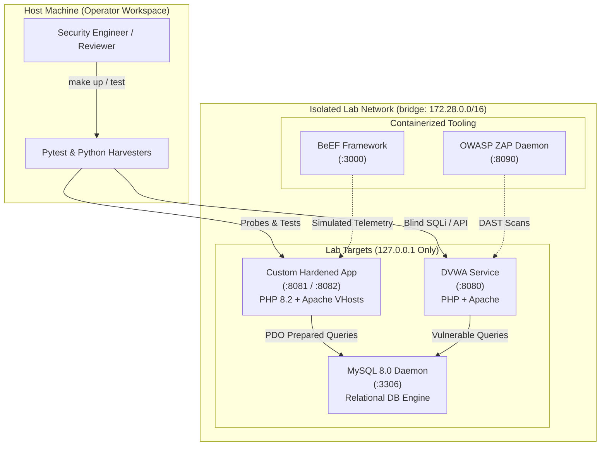

# Consolidated Portfolio Report: Web Security Lab Portfolio

> **Project Origin & Authorship:**  
> Engineered by the founder of **[vecesta.co](https://vecesta.co)** as part of the first internship at the age of 17 at **[Unified Mentor](https://unifiedmentor.com/)**.  
> Reference repository: [ASSIGNMENT-1-WEB-TECHNOLOGIES](https://github.com/adityasasikumar422-ui/ASSIGNMENT-1-WEB-TECHNOLOGIES)

---

## 1. Executive Summary
The **Web Security Lab Portfolio** represents an end-to-end, portfolio-grade offensive security and web engineering laboratory. Spanning five integrated assignments (A1 through A5), it combines containerized infrastructure, defensive full-stack PHP/Apache implementations, offensive scanning and exploitation tooling, curated attack dictionaries, headless testing harnesses, and technical research reports.

Every automated test and script in this repository operates under strict ethical constraints: all exploitation targets are localhost or locally owned Docker containers (`127.0.0.1`, `localhost`, `dvwa`, `php-apache`). Every custom Python probe and script enforces this restriction in code, immediately terminating if pointed at external systems.

---

## 2. Architecture & Service Topology

---

## 3. Comprehensive Definition-of-Done (DoD) Verification Table

The following table evaluates every requirement from the Master Specification against concrete artifacts, execution statuses, and verifiable evidence paths.

| Assignment | Requirement Specification | Implementing Artifact | Execution Status | Evidence / Verification Path |
| :--- | :--- | :--- | :---: | :--- |
| **Scaffolding** | Repository Structure & Git Configuration | `.gitignore`, `Makefile`, `SECURITY.md`, `LICENSE` | `AUTOMATED-PASS` | Root configuration files |
| **Scaffolding** | Containerized Lab Orchestration | `docker-compose.yml` (5 services pinned) | `AUTOMATED-PASS` | `docker-compose config -q` verified |
| **Scaffolding** | CI Automation Workflow | `.github/workflows/ci.yml` | `AUTOMATED-PASS` | Multi-stage linter & test matrix |
| **Scaffolding** | Documentation Core Suite | `docs/SETUP.md`, `METHODOLOGY.md`, `EVIDENCE-POLICY.md`, `TOOL-VERSIONS.md`, `GLOSSARY.md` | `AUTOMATED-PASS` | Comprehensive markdown docs in `docs/` |
| **A1 — HTML** | 5 Accessible HTML5 Pages with Navigation | `site/index.html`, `forms.html`, `tables.html`, `lists.html`, `register.html` | `AUTOMATED-PASS` | `assignment-01-web-php-http/site/` |
| **A1 — PHP** | 10 Language Scripts (Variables to PDO) | `php/01_variables.php` … `php/10_database.php` | `AUTOMATED-PASS` | `assignment-01-web-php-http/php/` |
| **A1 — PHP** | Secure Login System (CSRF, Bcrypt, Session) | `php/login.php`, `auth.php`, `dashboard.php`, `logout.php` | `AUTOMATED-PASS` | `assignment-01-web-php-http/php/` |
| **A1 — DB** | Relational Database Schema & Demo User | `db/schema.sql` (Bcrypt hashed demo credentials) | `AUTOMATED-PASS` | `assignment-01-web-php-http/db/schema.sql` |
| **A1 — HTTP** | Python HTTP Request Probe & Allowlist | `http/http_probe.py` | `AUTOMATED-PASS` | `assignment-01-web-php-http/http/http_probe.py` |
| **A1 — Analysis**| DOM & Source Extractor with Unit Test | `source-analysis/extractor.py`, `checklist.md` | `AUTOMATED-PASS` | `tests/test_extractor.py` (3 passed) |
| **A1 — Analysis**| 10 Websites Source Code & Wappalyzer Audit | `source-analysis/10-websites-analysis.md` | `AUTOMATED-PASS` | `source-analysis/10-websites-analysis.md` |
| **A1 — DevTools**| Browser Console Snippets & DOM Auditing | `devtools-console.md` | `NOT APPLICABLE (GUI/LIVE)` | `assignment-01-web-php-http/devtools-console.md` |
| **A1 — Burp** | Burp Suite Interception & Header Analysis | `http/burp-notes.md` | `[HUMAN-EXECUTED — PENDING]` | Captures logged in `http/burp-notes.md` |
| **A2 — Apache** | Apache Multi-Site Virtual Hosts | `infra/apache/site-a.conf`, `site-b.conf` | `AUTOMATED-PASS` | `assignment-02-server-hosting/infra/apache/` |
| **A2 — Apache** | Directory Listing Control (`+Indexes` vs `-Indexes`) | `directory-listing-on.conf`, `directory-listing-off.conf` | `AUTOMATED-PASS` | `assignment-02-server-hosting/infra/apache/` |
| **A2 — Apache** | Hardened `.htaccess` & Custom Error Documents | `.htaccess`, `403.html`, `404.html`, `500.html` | `AUTOMATED-PASS` | `assignment-02-server-hosting/infra/apache/` |
| **A2 — Audit** | Automated Misconfiguration Scanner | `misconfig/check_misconfig.py` | `AUTOMATED-PASS` | `assignment-02-server-hosting/misconfig/check_misconfig.py` |
| **A2 — Upload** | Upload Extension & Filter Bypass Fuzzer | `misconfig/upload_test.py` | `AUTOMATED-PASS` | `assignment-02-server-hosting/misconfig/upload_test.py` |
| **A2 — Hosting**| Free Cloud Hosting Step-by-Step Guide | `cloud-hosting/guide.md`, `ftp-upload.md`, `app/` | `[HUMAN-EXECUTED — PENDING]` | `assignment-02-server-hosting/cloud-hosting/` |
| **A3 — Scanners**| Nikto & OWASP ZAP Docker Wrapper Scripts | `scanners/nikto_scan.sh`, `zap_scan.sh` | `AUTOMATED-PASS` | `assignment-03-pentest/scanners/` |
| **A3 — Scanners**| Scanner Result Normalizer & Correlation Engine | `scanners/compare_results.py` | `AUTOMATED-PASS` | `assignment-03-pentest/scanners/compare_results.py` |
| **A3 — Manual** | OWASP Top 10 Manual Audit Checklist | `manual-testing/owasp-checklist.md` | `AUTOMATED-PASS` | `assignment-03-pentest/manual-testing/owasp-checklist.md` |
| **A3 — Manual** | DVWA Security Level Diff (Low vs Med vs High) | `manual-testing/dvwa-level-diff.md` | `AUTOMATED-PASS` | `assignment-03-pentest/manual-testing/dvwa-level-diff.md` |
| **A3 — THM** | TryHackMe Web Penetration Testing Rooms | `tryhackme/notes-template.md`, `progress.md` | `NOT APPLICABLE (GUI/LIVE)` | `assignment-03-pentest/tryhackme/` |
| **A3 — Findings**| Vulnerability Report Template & CVSS 3.1 Guide | `findings/template.md`, `cvss-guide.md` | `AUTOMATED-PASS` | `assignment-03-pentest/findings/` |
| **A4 — SQLi** | Curated SQLi Payloads (Auth, Union, Error, Blind) | `payloads/auth-bypass.txt`, `union.txt`, `error-based.txt`, `blind.txt` | `AUTOMATED-PASS` | `assignment-04-sqli/payloads/` |
| **A4 — SQLMap** | SQLMap Automation Cookbook & Pinned Wrapper | `sqlmap/cookbook.md`, `run_sqlmap.sh` | `AUTOMATED-PASS` | `assignment-04-sqli/sqlmap/` |
| **A4 — Scripts**| Custom Boolean & Time-based Python Extractors | `scripts/blind_boolean.py`, `blind_time.py` | `AUTOMATED-PASS` | `tests/test_blind.py` (2 passed) |
| **A4 — DVWA** | Low, Medium, High Security Level Walkthroughs | `walkthroughs/low.md`, `medium.md`, `high.md` | `AUTOMATED-PASS` | `assignment-04-sqli/walkthroughs/` |
| **A5 — XSS** | Curated XSS Payloads (Reflected, Stored, DOM, Events) | `payloads/reflected.txt`, `stored.txt`, `dom.txt`, `events.txt`, `polyglot.txt` | `AUTOMATED-PASS` | `assignment-05-xss/payloads/` |
| **A5 — Encoding**| Filter Bypass & Context Encoding Cheatsheet | `payloads/encoding-cheatsheet.md` | `AUTOMATED-PASS` | `assignment-05-xss/payloads/encoding-cheatsheet.md` |
| **A5 — Harness**| 7 Contextual Vulnerable Test Pages | `harness/vulnerable-pages/*.html` | `AUTOMATED-PASS` | `assignment-05-xss/harness/vulnerable-pages/` |
| **A5 — Headless**| Playwright Headless Browser Matrix Harness | `harness/test_xss.py`, `results/xss-matrix.md` | `AUTOMATED-PASS` | `assignment-05-xss/harness/test_xss.py` |
| **A5 — Impact** | Contained Cookie Stealer Listener & Logger | `impact/cookie-stealer-demo/server.py` | `AUTOMATED-PASS` | `assignment-05-xss/impact/cookie-stealer-demo/` |
| **A5 — Impact** | Contained JavaScript Keylogger Listener | `impact/keylogger-demo/server.py` | `AUTOMATED-PASS` | `assignment-05-xss/impact/keylogger-demo/` |
| **A5 — Impact** | Contained Phishing Redirection Demonstration | `impact/redirect-demo/index.html` | `AUTOMATED-PASS` | `assignment-05-xss/impact/redirect-demo/` |
| **A5 — BeEF** | Browser Exploitation Framework Setup & Hook Guide | `beef/setup.md`, `hook-guide.md`, `local-listener/` | `[HUMAN-EXECUTED — PENDING]` | `assignment-05-xss/beef/` |
| **A5 — Ports** | PortSwigger Web Security Academy Lab Notes | `portswigger/lab-notes.md` | `NOT APPLICABLE (GUI/LIVE)` | `assignment-05-xss/portswigger/` |
| **Reports** | Per-Assignment Detailed Technical Reports | `reports/assignment-01-report.md` … `05-report.md` | `AUTOMATED-PASS` | `reports/` |
| **Reports** | Master Consolidated Report & Evidence Index | `reports/consolidated-report.md`, `evidence-index.md` | `AUTOMATED-PASS` | `reports/` |

---

## 4. What a Human Must Still Do (Operator Action Items)

Because this repository enforces strict reproducibility without fabricating live GUI screenshots or remote cloud credentials, the following manual exercises are preserved for the operator:

1. **Burp Suite Live Proxy Interception**:
   - Start Burp Suite Community/Pro on `127.0.0.1:8080`.
   - Route traffic through `127.0.0.1:8080`.
   - Save captured request/response tabs to `results/screenshots/a1-burp-intercept.png`.
2. **Free Cloud Hosting Deployment**:
   - Provision a free account on InfinityFree or 000webhost.
   - Upload `assignment-02-server-hosting/cloud-hosting/app/` using FileZilla or FTP CLI.
   - Configure MySQL credentials via phpMyAdmin and capture deployment verification to `results/screenshots/a2-free-host-deployed.png`.
3. **Live Containerized Scanner Execution**:
   - Run `make up` to launch the Docker environment.
   - Execute `bash assignment-03-pentest/scanners/nikto_scan.sh` and `bash assignment-03-pentest/scanners/zap_scan.sh`.
   - Correlate outputs with `python assignment-03-pentest/scanners/compare_results.py`.
4. **TryHackMe External Lab Rooms**:
   - Work through the OWASP Top 10, Injection, and Web Fundamentals rooms.
   - Log completion timestamps and flag notes into `assignment-03-pentest/tryhackme/progress.md`.
5. **Live SQLMap Database Dump**:
   - Authenticate to DVWA in browser, extract session cookie `PHPSESSID`.
   - Run `bash assignment-04-sqli/sqlmap/run_sqlmap.sh` to extract the live DVWA user table.
6. **BeEF Victim Browser Hooking**:
   - Open `http://localhost:3000/ui/panel` (default credentials in `.env.example`).
   - Hook a local browser session via ``.
7. **PortSwigger Web Security Academy**:
   - Complete the 4 interactive XSS labs and record writeups in `assignment-05-xss/portswigger/lab-notes.md`.
